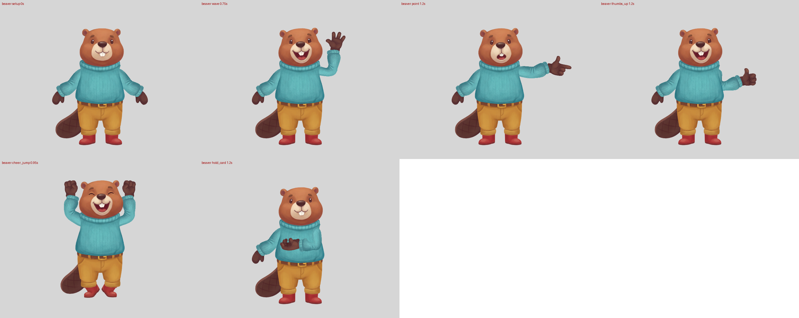

# Beaver rig + Jev as a hand-direction judge (2026-10-15)

Two goals:
1. Take a fresh character from text to a rigged, QA-passing Spine skeleton with Jev in the loop.
2. Test the one thing the [rig-judge experiment](../2026-10-12-clef-judge/README.md) didn't: can Jev judge which way a part points? The parts tested are hands: fingers, thumb, palm or back, and pose.

**Verdict.**
- **Jev reads coarse direction and pose well.** On the fox and moose hands:
  - fingers: 96% within 45°, median error 7°;
  - thumb: 82% within 45°;
  - pose: 91%;
  - "is the thumb up" on rendered frames: AUROC 0.99.

  The earlier "nudge N px" direction failure was about pixel offsets. Turning a hand by 45° steps is a different, semantic question, and Jev handles it.
- **Asked directly, Jev does not read palm vs back, or left vs right hand.** Both are near chance (palm/back AUROC 0.61).
  - Round 2 fixed palm/back: five visible cues, combined in code, reach AUROC 0.89. Averaged over 16 turns per piece and read through a "palm / ask / back" band, they give 12 of 13 confident calls right on the fox and moose. That is in-sample: the bands were set on those same pieces, and three beaver palms sat within 0.011 of the palm cut-off, so re-check it on the next character.
- **So ask Jev only what it can see, and apply anatomy in code.** Jev gives the finger and thumb directions, the annotation gives palm or back, and the existing anatomy rule names the hand. On the fox and moose frames, that rule catches 91% of planted mirrored hands at 7% false alarms. Asking Jev "is this hand mirrored?" scores AUROC 0.42.
- **Round 2: the first rig looked broken, although it passed every check.**
  - What was wrong: stuck-on sleeves, a broken elbow, a neck gap, no trouser cuffs, boots off-centre, an upside-down tail, and fists showing their backs in cheer_jump.
  - Jev compared each joint with the master and with the approved rigs, and ranked the same joints worst.
  - New art and annotations improved 9 of 11 joints by Jev's own before/after comparison.
  - A pipeline fix closed the wrist spill: `rig_mesh._edge` had read the knit's ripples as sleeve edges.
  - The beaver now passes all 15 `spine_qa` checks.



Build you reviewed (left of each pair) against round 5 (right): `beaver/frames_v2_vs_final.png`.

## The beaver
- **Master** (`prompts/master-textonly.txt`): the skill's master prompt with no design reference. The hippo and raccoon atlases are the only images, and the character is text only (`prompts/beaver.env`). There were two variants: 01 passed `spine_qa --contract`, and 00 failed on a faint shadow.
- **Sheets:** body, hands, poses and face, 4 Nano Banana Pro calls run in parallel (`scripts/gen_sheets.sh`).
  - The poses sheet's arm row came back as whole sleeves, the fox's old failure. The raised sleeve was dropped instead of re-rolled.
  - Row 2 of the hands sheet repeats row 1 unmirrored, so it is spare.
  - The palm-facing point hand was one more call (`prompts/hands-point-palm.txt`), 7 Nano Banana Pro calls in all.
- **Annotations:** `beaver/draft_annotations.py`, read off gridded pieces (`scripts/grid_pieces.py`). `scripts/locate.py` finds each piece's position on its sheet, which tells left from right. The user approved the master and all four sheets at one checkpoint.
- **Fix rounds after `spine_qa`:**

  | Failure | Cause | Fix |
  |---|---|---|
  | Torso detached from the hips, every frame | Sweater hem and belt top met edge to edge | Torso waist above the hem (0.90), hips waist inside the belt (0.12) |
  | Legs 74 px off, hips stretch 0.58, `ground_miss` | The hips piece is long shorts whose openings already reach the master's hem | Legs ignored; boots tucked under the trouser openings (the moose's layout) |
  | Elbow and wrist landmarks off, arm stretch 0.66-0.79 | The sheet's arm pieces are about 1.3x the master's arm | Shoulders moved in and up; elbows at the pieces' upper-arm share of shoulder to wrist (stretch doubts at 0.83-0.85 remain) |
  | Tail upside down | The matcher's rotation range can't turn the sheet's tail 180° | `mirror: true` on both tails; a quarter turn then fits |
  | `jerky_bones` on point and hold_card | **Pipeline:** a gesture raised the arm in 0.6 s and lowered it in 0.55 s. The beaver's long arm swinging to and from across the chest broke the 1.2%/frame limit | `rig_anim.GESTURE_RAISE/LOWER` at 0.7 s each, swaps halfway through each. Fox and moose rebuilt with it still pass all 15 checks; all 369 tests pass |
  | Point reads as a grip (Jev), hand hidden against the sweater | The back-facing point hand makes the rig choose the across pose | Palm-facing point hand, which points outward with the thumb 5° from up |

## The hand-direction experiment
- **Test sets** (`scripts/hands_set.py`, exact ground truth). Angles are measured in the image, with y up.
  - **A, pieces:** every annotated hand piece of the fox and moose (19), turned in 45° steps and mirrored, 304 items.
    - Fingers: wrist to fingertip (or to the centroid, for a fist).
    - Thumb: `rig_hands.thumb_vector`.
    - Palm or back: from the user-confirmed annotation.
    - Which hand the drawing shows: the anatomy rule.
  - **B, rendered frames:** hand crops of the approved fox and moose rigs, at holds and at five times in each gesture. Each gesture frame has a planted mirror: the hand reflected across its own axis, on the matrix so nothing is clipped. That is the "thumbs-up pointing down" defect. 120 items, 54 mirrored.
  - **Held out:** the beaver: 112 pieces, plus 60 frame crops from its rigs before and after the point fix.
- **Questions** (`scripts/run_hands.py`):
  - 8-way finger direction and 8-way thumb direction (scored by the bin and by the probability-weighted circular mean);
  - palm/back;
  - pose (6);
  - left/right hand;
  - on frames: a "thumb up" noul and a "mirrored" noul.
- **Conditions:** text criteria, or example images in the criteria (2 palm, 2 back, 2 left, 2 right, all from other characters).

| | Fox + moose pieces (304) | Fox + moose frames (120) | Beaver pieces (112, held out) | Beaver frames, final (60) |
|---|---|---|---|---|
| Finger direction within 45° (median error) | **96%** (7°) | **95%** (11°) | 80% (9°) | 87% (9°) |
| Thumb direction within 45° (median error) | **82%** (13°) | 79% (17°) | 76% (10°) | 90% (14°) |
| Pose | 91% | 92% | 69% | 80% |
| Palm/back AUROC, text / with examples | 0.61 / 0.79 | 0.50 / 0.60 | 0.39 / 0.60 | 0.80 / n/a |
| Left/right hand, asked directly | 51% | 54% | 48% | 58% |
| Left/right from Jev's directions + annotated facing | **94%** | 92% | **98%** | n/a |
| Thumb-up noul AUROC | n/a | **0.99** | n/a | **1.00** |
| "Mirrored" noul AUROC | n/a | 0.42 | n/a | 0.51 |
| Mirror rule, Jev's facing: TPR / FPR | n/a | 0.39 / 0.67 | n/a | 0.41 / 0.52 |
| **Mirror rule, annotated facing: TPR / FPR** | n/a | **0.91 / 0.07** | n/a | **1.00 / 0.11** |

Example images help palm/back (0.61 → 0.79 on the fox and moose) but not enough to trust it, and they cost 3.5x the tokens. They don't move the direction answers. Full numbers are in `results/*/scores_*.json`.

## Jev in the pipeline
- **Before a hands checkpoint:** `scripts/jev_annotate.py <annotations.json> --exemplars <pieces set>` (one call per hand).
  - It compares Jev's pose with the annotated variant.
  - It compares the thumb side from Jev's directions with the one from the annotated points. Both use the annotated facing, so a mismatch means a wrong `thumb_tip` or `fingertip` point.
  - It raises a facing doubt only when Jev is confident (P ≤ 0.2 or ≥ 0.8). On the beaver it agreed with every thumb side. It flagged that the rest mittens look like thumbs-ups and the "open" wave hand is barely spread: fair readings of the art, not errors.
- **After the rig passes `spine_qa`:** `scripts/jev_rig_check.py <char>=<rig dir>` (5 calls, about 2 s).
  - **FAIL** when a point or thumbs-up hold doesn't show the thumb up. This is the only check reliable enough to gate on.
  - **WARN** when:
    - the hold doesn't read as its pose (P < 0.3);
    - a point aims across the body;
    - the anatomy rule says the hand may be the other one. On single frames it false-alarmed on the approved fox and moose waves until it was limited to thumbs clearly square to the fingers, and the moose wave still warns.

  On the three approved rigs it gives no FAIL. It warns on the moose wave (false alarm) and on the beaver hold_card, whose grip hides behind the sleeve and reads as a fist.

## Takeaways
1. **Use Jev for direction and pose, never for palm/back or handedness.** Composing typed judgments in code beats asking the compound question: 0.91/0.07 against 0.42 AUROC.
2. **"Does this hold read as the gesture?" is the new signal.** `spine_qa` passed the across-body point (its thumb was within 20° of up), yet it read as a grip and pointed at the beaver's chest. Jev's pose and finger answers caught it. Geometry can't see that a pose doesn't read.
3. **The thumb-up check is gate-quality** (AUROC 0.99-1.00 on frames). It catches exactly the "thumbs-up pointing down" defect that once passed every metric.
4. **Not caught yet:** the grip mitten at hold_card is half hidden on every character, and Jev reads it as a fist (P(grip) 0.06 on the beaver). Painting a visible grip, or a card in the hold, would help both viewers and Jev.
5. **Cost:** 1,215 Jev calls, 4.4M input tokens, about $0.19, median latency 0.45 s. Images must be at least 320 px a side (round 5); crops are 448 px.

## Reproduce
```
scripts/gen_sheets.sh                                     # body, hands, poses, face sheets (needs the approved master)
uv run scripts/hands_set.py pieces <dir> fox=../2026-10-11-rig-annotations/fox/annotations.json moose=...
uv run scripts/hands_set.py holds <dir> fox=../2026-10-11-rig-annotations/fox/rig moose=...
python3 scripts/run_hands.py <dir> text|exemplar [--exemplars-from <pieces dir>]
python3 scripts/score_hands.py <dir> text exemplar
uv run scripts/jev_annotate.py beaver/annotations.json --exemplars <pieces dir>
uv run scripts/jev_rig_check.py beaver=beaver/rig
```
Key: `TYPESAFE_API_KEY` in `~/.config/typesafe/typesafe.env` (mode 600). The scripts use `jev-1.14.0` and the `TypeSafe-Danger-Zone-Images` header. Rig build: `spine_rig.py --master beaver/beaver_master.png --annotations beaver/annotations.json --out beaver/rig`, then `spine_qa.py`.

## Round 2 (user review): hinge quality, fists, and Jev beside `spine_qa`
The review said the parts looked staged badly: shoulders and arms different sizes, arms sitting on top of the shoulders, boots misaligned, the tail off, and the cheer fists turned backwards. The cause was in my annotations and in sheet art that didn't fit the master, not in the checks.

**Diagnosis.**
- `scripts/joint_crops.py` renders the rig into the master's own pixel frame, so every joint can be cropped at the same box from both (`results/round2/joints_v2_reviewed.png`).
- The defects it showed:
  - **Shoulders:** my round-1 fix had moved them up into the collar.
  - **Elbows:** two round sleeve ends overlapped.
  - **Neck:** a fur gap between head and collar.
  - **Ankles:** no trouser cuffs, because the leg pieces were ignored.
  - **Tail:** smaller and turned.
- The cheer fist was a back-facing drawing raised to the sky. My 0.5-confidence "back" label was right, but nothing judged whether the pose would read.

**Fixes** (rounds 3-5, `beaver/rebuild.sh` rebuilds from scratch):

| Joint | Fix |
|---|---|
| Arms | Whole sleeves (one bending mesh per arm, `prompts/sleeves-pair.txt`), under the torso so they grow out of the sweater's shoulder. The poses-template sleeves sheet had faded hippo ghosts merged into the cuffs; a two-piece "large, filling the sheet" prompt fixed that |
| Fists | Palm-facing fist (`prompts/hands-fist-palm.txt`). Jev's cue score put the old fist at -0.40 (back) and the new one at -0.05 (palm) |
| Trousers | `beaver/make_trousers.py`: belt-to-crotch hips over the two cuffed legs (one piece, so the boots stay under the cuffs), painted at the rig's scale, legs narrowed to the master's width, hips rim de-fringed. Boots centred under the legs from colour measurements of the master |
| Tail | Repainted as the master holds it. The "tail only" call came back as a whole second body sheet whose tail fits |
| Neck, waist | Torso neck point inside the collar, waist points so the whole belt shows |
| Hands | The rig sizes a hand by the master's wrist-to-fingertip, and the master's wrist is where the mitten leaves the cuff, so the fingertips moved out: final 1.05x, straight along the sleeve (`scripts/sweep_hands.py` sweeps size and angle; after the width-fit fix, 1.1x turned 0.7 of the way still spilled 3.5%) |

**`spine_qa` now: 15 of 15 pass** (sockets spill 2.6% left, 2.4% right, against a 3% limit).
- **Before the fix:** round 5 failed sockets at 4.0% and 6.8%. The right side traced to `rig_mesh.width_fit`.
- **The bug:** the beaver's sweater and sleeves are the same turquoise knit, and `_edge` took knit ripples (about 0.06 per channel) for the sleeve's edge. On the right, a ripple inside the torso even counted as a crease, which gave the upper half 2 samples. That switched on re-centring, which moved the lower half 117 px off.
- **The fix** (`rig_mesh._edge`, in a separate session with 2 regression tests): a step whose far side is the sleeve's own colour, and isn't under a part drawn over the sleeve, is a ripple, so keep walking. Once inside such a part with no crease, the edge is hidden.
- **Result:** both sides now fit the same, factor 1 and offset 0. Fox and moose still pass 15/15.
- **Side effect:** the fox's upper sleeve is no longer narrowed (0.88/0.91 → 1.0); a shading gradient had passed for a crease. The approved fox rig files are unchanged until it is rebuilt.
- **Hands:** the fingertips then needed 1.05x, straight along the sleeve.

**Jev beside `spine_qa`** (`scripts/jev_qa.py`, about 200 calls, about $0.02 per run). Jev's absolute answers carry little: every joint of the approved fox and moose scores P(matches master) < 0.5. Its comparisons carry a lot:
- **Joints against approved rigs:** a joint is flagged when Jev's 0-3 "broken" score is above the worst approved fox/moose joint of that type. Final: shoulder_r and both ankles are still above.
- **Pairs against the previous build:** "which render matches the master better", both orders averaged. Final against the reviewed build:

  | Better | Worse |
  |---|---|
  | shoulders 0.91/0.77, elbows 0.75/0.74, neck 0.95, waist 0.87, ankles 0.89/0.89, tail 0.95 | wrists 0.16/0.38 |

  - Jev still prefers the reviewed build's wrists, where the cuff hid a smaller mitten, although both wrist scores improved (1.85/1.81 → 1.66/1.61) and now sit inside the approved range.
  - By eye, the final mittens tuck under the cuff as in the master (`results/round2/joints_final.png`). Treat this as a disagreement, not a regression.

  On unchanged joints it reads about 0.5, except one tail pair (0.32) on crops that barely differed: treat one pair as noise, a pattern as signal.
- **Frames:** 6 per animation, P(defect), listed when above the approved rigs' 90th percentile. In round 5 it put hold_card and point first; after the wrist fix only hold_card's half-hidden grip is above the approved rigs' 90th percentile (`results/round2/frames_to_review.png`).
- **Holds:** `jev_rig_check.py`. All five gestures read as intended; hold_card's grip moved from "fist" (P(grip) 0.06) to "grip" (0.69).

## Jev call report (all of this experiment)

| # | Calls | Purpose | Cost | Impact |
|---|---|---|---|---|
| 1 | 1,192 | Hand-direction experiment: fox/moose pieces and holds, beaver held out | $0.18 | Knowledge, no rig change: Jev reads finger and thumb direction, pose, and thumb up (AUROC 0.99); it doesn't read palm/back or handedness directly |
| 2 | 8 | Cross-check of the beaver hand annotations | <$0.01 | **None.** It agreed on every thumb side and flagged only fair readings of the art. It did ask palm/back (with example pictures) but was never confident (P(palm) 0.28–0.51), so it raised no facing doubt |
| 3 | 15 | Hold check on the rigs | <$0.01 | **One real catch:** the first point read as a grip across the chest, fixed with a palm-facing hand. It missed the backward cheer fists, because cheer has no thumb rule and facing wasn't asked |
| 4 | 43 | Joint audit against the master (first pass) | <$0.01 | **Confirmed the review:** the reviewed build's shoulders, elbows, neck and ankles scored worst (2.1-2.35). It also showed that a 0.5 threshold flags the approved rigs too |
| 5 | 304 | Palm/back from visible cues, on the fox and moose | $0.02 | **New capability:** palm/back AUROC 0.61 → 0.89 |
| 6 | 160 | Palm/back of every beaver hand (cue method, 16 turns each) | $0.01 | **Confirmed, after the fact:** the old fist scores -0.40 (back) and the new fists palm. It would NOT have raised the cheer fist: that fist was correctly labelled back, and the check only fires when Jev disagrees with the label. The problem was the pose, not the label. It disagrees on the grip (asked, not acted on) |
| 7 | 856 | Four Jev QA runs: joints against approved rigs, pairs against the previous build, frames, holds | $0.07 | **Measured, steered little:** it found the wrist regression (seen by eye too). The pairs rated the ankles better every run; what persisted was the ankles and shoulder_r staying above the approved rigs' worst, and those WARNs weren't acted on until round 6. It also measures the improvement: 9 of 11 joints better than the reviewed build, wrists judged worse (see above) |
| | **2,578** | | **$0.29** (6.8M input tokens) | |

The separate session that moved these tools into the skill made its own validation runs on fox, moose and beaver (about 180 calls a run, answers cached by image); they aren't counted here.

What Jev did not do: no fix direction or size came from it. Every correction came from looking at the aligned crops and from code (colour measurements of the master, the hand sweep). Jev's value is as a cheap second reviewer that ranks and compares: it confirmed every problem in the review and caught the point pose, but it never found anything I couldn't see once the crops were aligned. The crops themselves (`joint_crops.py`) were the biggest single improvement to the review loop.

## Rounds 6-7 (second review): hands vs cuffs, waist gap, boots, proportions
The second review said the hands looked bigger than their joint and slightly disconnected, the waist showed a curvy hem with white space at the belt, the boots peeked a thin line beside the trousers, and the lower body's size didn't match the master.

**How it was found** (no Jev): two new review sheets showed every one of these at a glance.
- `scripts/onion.py`: master | rig | onion. The master is in red and the rig in cyan, so a too-wide, too-thin or offset part shows as a coloured fringe.
- `scripts/motion_crops.py`: wrists, waist and ankles followed through the animations.
- Colour measurements (`scripts/measure_lower.py`) gave the numbers.

**The causes and fixes:**

| Defect | Cause (measured) | Fix |
|---|---|---|
| Hand bigger than its joint | The master's sleeves and cuffs are fat (lower sleeve 1.32x the sheet's), and the width fit only ever narrows, so the cuff was narrower than the mitten | `beaver/make_sleeve_wide.py` widens the sleeve drawing, tapered: unchanged to the elbow, 1.32x at the cuff. A uniform 1.3-1.45x folded the mesh at hold_card's -103 deg elbow. Hands back near the master's own angle (size 1.0, turned a third of the way toward the sleeve) |
| White space at the belt | The upper trousers were 10-13% wider than the master's (0.282-0.717 vs 0.312-0.693 at the belt), so the belt's corners stuck out past the sweater hem | Hips narrowed 0.88 in `make_trousers.py`; the cuffed legs keep their place |
| Boots peeking beside the cuffs | Boots about 0.017 of the width too far out: the master's boot tops are centred at x 0.407 and 0.599 | Master ankle points moved there |
| Pale seam above each cuff | The shorts' painted bottom edge over the leg piece | The last 6 px of the hips' outline over each leg hand back to the leg underneath, feathered |

**Result:** 15 of 15 `spine_qa` checks pass. Silhouette match 0.88 → 0.92; hand spill 1.8% / 1.3%; the tapered sleeve folds cleanly over the full -103 deg to 80 deg elbow range. Fox and moose still pass 15/15.

**What Jev said** (`jev_qa.py` against the committed round-5 build):
- **Better:** waist 0.60, left ankle 0.70, tail 0.73.
- **About the same:** the rest, including the wrists (0.43 / 0.38).
- **Frames:** hold_card and point stay first on the review list.

Jev's joint crops are rest-pose only and coarse, so it barely registers the cuff and in-motion fixes. Here the onion and motion sheets were the better detector.

**QA changes:**
- **Kept:** `joint_crops.py` in the skill now also writes `rig/qa/onion.png` and `rig/qa/motion.png`, the two sheets that found every round-6 defect. Read them at checkpoint 6.
- **Tried and dropped: a boots-in-trousers socket** (`spine_qa` sockets, spill only). It passed the moose, but on the beaver with the old, outward boots it read only 0.8% spill. A thin sliver beside the cuff is too small a share of the boot's area to trip a 3% limit, so it would not have caught the defect it was written for.
- **Tried and dropped: banded silhouette IoU** (12 bands against the master). The approved fox (feet band 0.63) and moose (antlers 0.58) score as low as the beaver, so no threshold separates them.
- **Not caught by any check yet:** a part a few px off, or a sliver showing beside another part. Those still need the onion and motion sheets and a person.
- **Still open:** the arms hang a little steeper than the master's. At rest the mitten sits about 20 px low and inward.

An independent review of every Jev use (a subagent read the code and result files at commit 0e5a919) is published as a private page. It found the three README claims corrected above.

## New animations: walk, run, squat, jump over a hurdle, wave a white flag
Five body moves were added to `rig_anim`, so every rig gets them. All are front view and in place (`frames_new_anims.png`; GIFs in `beaver/rig/qa/`):
- `walk` (1 s loop) and `run` (0.64 s loop): the hips bob and sway, the feet take turns stepping toward the viewer, and the arms swing (in `run`: bent, fists at the waist).
- `squat` (2 s): there are no knees to bend, so the trousers shorten and the body drops while the feet stay on the ground, arms out for balance.
- `jump_hurdle` (one-shot): crouch behind a hurdle drawn in front of the legs, leap toward the viewer over it (it moves behind at the apex), land nearer, arms out for balance.
- `wave_flag`: the fist holds a white flag upright, raises it and swings it while the cloth flutters.

**Props.** The flag and the hurdle aren't in the master, so they come from one `props-pair.txt` call and a small `beaver/props.json` with grip, tip, base and height (`spine_rig.py --props`, `scripts/rig_props.py`). Each prop gets its own bone, hidden at rest:
- the flag on the left fist, drawn behind it so the fist closes over the stick;
- the hurdle on the root, in front.

**Same moves on fox and moose.** The same props file works on the fox and the moose. The animations adapt to how each character is built: the fox's boots are worn over its trousers, so they ride with the hips instead of lifting off them.

**QA:** beaver, fox and moose each pass all 20 `spine_qa` checks (15 plus the 5 new animations), and 391 tests pass (3 new in `tests/test_props.py`). Two `spine_qa` rules changed for props:
- a slot with no attachment at rest (a prop) is neither judged for occlusion nor counted as hiding the body;
- a bone that draws nothing in an animation isn't checked for jerks.

**Tuning learned from the jerk check:**
- Ease arm raises with smootherstep: cubic easing kicks at the start.
- Keep the arms still at the jump's apex.
- Give the fist 0.9 s to rise, since the flag's bone sits beyond the hand.
- Spread the push-off over 0.28 s.
- A rig with leg pieces must measure the squat from where the legs hang, not from the feet.
