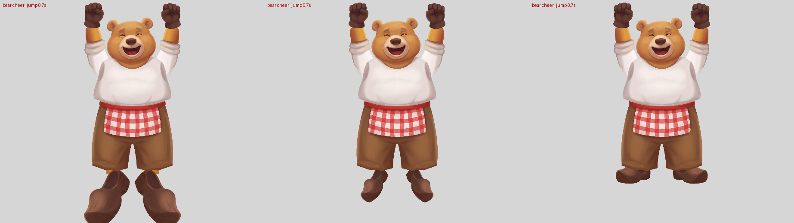
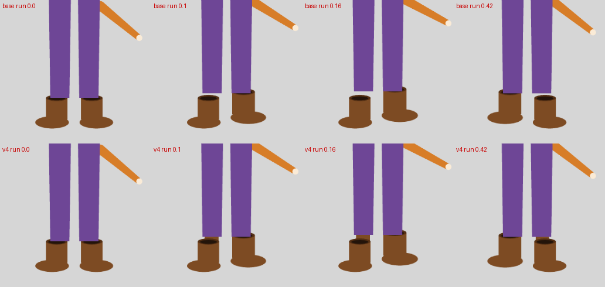

# Pipeline fixes from the 2026-10-16 cast

The rabbit, red panda and bear agents weren't allowed to edit shared code, so they worked around pipeline bugs with
experiment-local scripts (see each README's "Pipeline issues found"). This note covers the five fixes folded back into
`plugin/skills/skipbo-art/scripts`. Each fix has a regression test in `tests/test_pipeline_fixes.py`. The committed
cast rigs were not rebuilt.

*Bear `cheer_jump` at 0.7 s, with the tiptoe clog restored. Left: old code (tiptoe scaleX 1.13 against the rest
clog's 1.00). Middle: fixed (0.67, scaled by area). Right: the committed rig, which dropped the tiptoe.*

## 1. Tiptoe / pose-variant sizing (`rig_place.variant_fit`, `rig_variants`, `spine_qa`)

- **Bug:** a foot variant was scaled by the ratio of its ankle widths. On the bear, the tilted tiptoe clog's ankle
  snapped to its 137 px heel rim. The rest clog's snap failed, so its width was a 362 px cross width. The tiptoe got
  scaleX 3.17, and it passed `spine_qa` because it still covered its joint.
- **Fix:** a foot variant's width ratio is now checked against the two images' area ratio (a tiptoe is the same foot
  at its sheet's scale). If they differ by more than 1.3x either way, the area ratio is used and the build raises a
  `variant_scale_disagree` doubt. The doubt records `width_ratio`, `area_ratio` and the two snap states, and the same
  fields go into `report.json` under `variants.<att>.scale_check`.
- **New QA check:** `structure.variant_size` fails any variant (expression heads included) drawn more than 1.6x
  bigger or smaller than its rest attachment in the setup pose, measured as the square root of the drawn area.
  Legitimate variants in the six committed rigs measure 0.82-1.46. The round-4 bear clog would measure about 3.4.
  Because legitimate gestures reach 1.46, a variant only ~1.3x too big (the old code on today's stubbed clog, 1.37)
  still passes this check; the build-time doubt is what catches that one.
- **Bear check (`bear/tools/verify_tiptoe.sh`):** restores the tiptoe in a temporary copy. Without a stub, the
  correctly sized tiptoe fails `variant_misfit` (overlap 0.34 against the stubbed rest clog). So `make_tiptoe.py`
  gives it the rest clogs' hidden ankle stub (experiment-local art, like `make_parts.py`). Result: all 20 `spine_qa`
  checks pass, `variant_size` included, IoU 0.918. The rig in `bear/rig/` still has no tiptoe; it wasn't rebuilt.

## 2. Global scale (`rig_place.scale_estimates`, used by `global_scale` and `spine_rig`)

- **Before:** the scale came from the torso's neck-to-waist alone, with no cross-check.
- **Now:** neck-to-waist (`torso_length`) is compared with two more estimates:
  - `torso_width`: the master's width across the torso against the piece's, at 30-80% of neck to waist. A sample row
    is dropped when its run crosses an annotated shoulder-elbow-wrist line, i.e. the arm touches the body there.
  - `head_width`: the head's width at the cheeks, 30-40% of the head piece's height above the neck.
- **Rule:**
  - `torso_length` stays the scale unless the other two estimates agree with each other (within 12%) and both lie more
    than 15% from it. Then their median is used (`used: others`). This is the rabbit's low torso waist point, which
    shrank the rig to IoU 0.64 silently.
  - Any estimate more than 15% off the scale used raises a `scale_disagree` doubt, with `estimates` and `off_by`.
- **Effect on the existing rigs:** fox, moose, beaver, bear, rabbit and red panda all keep their scale. Only the red
  panda raises a doubt (head 1.18x). Its head_base is matched at 1.10x anyway.
- **Limit:** the bear's chunky torso stays undetectable. Its master's arms touch the body at every torso row, so
  there's no `torso_width` sample. A shoulder-span measure didn't separate it from the other characters either.
  `torso_width` only helps when the arms hang clear of the body.

## 3. Contract key quality (`spine_qa --contract`: `keyable`)

- **Check:** the share of the silhouette that the pipeline's key (more than 0.06 from the border colour) misses. That
  means pixels inside the closed, hole-filled key that aren't flat background (`dist > 0.015`), so real background
  enclosed by an arm loop doesn't count.
- **Threshold:** fail at 1.5%. The rejected rabbit masters measure 4.5-7.6%. Every rigged master measures at most
  0.25%: fox 0.07, moose 0.20, beaver 0.06, bear 0.23, red panda 0.19, recoloured rabbit 0.19.
- **Dependencies:** numpy and PIL only (box-filter closing, PIL flood fill). The rabbit's `key_check.py` needed scipy.
- **New finding:** the recoloured `rabbit_master.png` now fails `arm_gaps` (picture-right 1% of rows). Its right paw
  touches the body. The original master passed that check only because its pale paws keyed out as background, as the
  rabbit README suspected.

## 4. One-piece trousers (`master.layers` `"leg": "in_hips"`, `rig_trousers.py`)

- **Problem:** all four trousered characters (beaver, rabbit, red panda, bear) asked the sheet for the whole lower
  body as one piece. That fights the template's "each leg in two", so the model painted shorts or belt-to-hem
  trousers, and each character rebuilt its trousers in a local `make_trousers.py`.
- **New option:** ask the sheet for what the template already asks: hips to the crotch plus two cuffed trouser legs.
  `body-sheet.txt` now says a trouser leg ends in a front-view cuff with no hole showing. Then set
  `master.layers.leg: in_hips`.
- **What spine_rig does:**
  - Composites the legs under the hips into one hips piece at the sheet's scale (`<out>/trousers/<char>_hips.png`).
  - Places each leg's hip into its opening, pushed in by a third of the depth and narrowed by up to 15%, as
    `rig_place` does.
  - Puts `hip_l` / `hip_r` at the cuffs and drops the leg outputs in memory, so the rig is leg-less with the feet
    under the cuffs. Annotate the master's `hip_l` / `hip_r` at the cuffs.
  - Docs: `spine-parts.md` stage 2 (PIECES wording) and stage 7.
- The feet's hidden shaft under the cuffs is section 5.

## 5. Leg-less feet: a hidden shaft under the cuff (`rig_shaft.py`, `rig_place`, `rig_variants.with_shaft`)

*The synthetic leg-less rig in `run`. Top: old code, the boots hang below the trouser legs (`detached`). Bottom: each
boot has a hidden shaft in its own colour, which shows only while the hips bob up.*

- **Bug:** a body-sheet boot is only as tall as the master's visible boot. With its ankle opening on the master's
  ankle at the cuff, almost none of it lies under the trousers. When walk and run bob the hips up with the feet
  planted, the boot comes out from under the cuff (`detached`, `unstitched`). The red panda stretched its boot shafts
  (`make_boots.py`), the bear painted a fur ankle stub (`make_parts.py` section 4, `tools/make_tiptoe.py`).
- **Fix:** an automatic step for every leg-less rig whose feet go under the hips (`foot: under_hips`, the default;
  one-piece trousers included). Each foot gets a shaft rising 6% of body height above its ankle opening, as wide as
  the opening. Its colours are the foot's own: per column, the lighter half of the opaque pixels just below the
  opening (the dark painted inside left out). It's drawn behind the foot. At rest it's kept only under the placed hips,
  inside one straight band that fits the narrowest trouser row it rises through, inset 8% of its width on each side.
  So the setup pose is unchanged, and a stepping foot's 1.08 scale can't push it out beside a wider turned-up cuff (a
  first version, clipped to the hips alone, showed a red sliver beside the beaver's cuff in `run`). The foot's points
  move down by the rows added. `cross_check` still judges the painted foot.
- **Variants:** a tiptoe gets the same shaft, as high in master px, kept where the rest's shaft is kept. It's still
  sized against the painted rest foot alone (no area-ratio skew). Without its own shaft the synthetic tiptoe's overlap
  with the hips drops to 0.09 of the rest's (`variant_misfit`, below 0.4); with it, 0.99.
- **Report:** `parts.<foot>.shaft` {rows, master_px, width_px, kept_px} and `variants.<att>.shaft` {rows, kept_px}.
- **Not applied:** rigs with leg pieces (the leg goes into the boot), and `foot: over_hips` (the boots go over the
  trouser legs and ride with the hips). The fox is byte-identical.
- **Existing rigs:** the moose and the beaver are leg-less with their feet under the hips, so they now get shafts.
  Their boots were tall enough already: rendering old against new over every walk, run and jump_hurdle frame changes
  no pixel. The committed bear and red panda rigs weren't rebuilt. Rebuilt with this code, they'd get a shaft on
  top of their hand-made one, hidden the same way.

## Verification

- `uv run --with pytest --with numpy --with pillow pytest tests -q`: 440 passed, 17 of them new. The legacy golden
  test (`test_rig_golden.py`) passes unchanged. The region-rig QA golden (`tests/golden/qa_region.json`) gained only
  the new, empty `structure.variant_size` key; nothing else in it changed.
- Legacy rigs rebuilt from today's code into a scratch folder (fox and moose from `2026-10-11-rig-annotations`, the
  beaver from `2026-10-15-beaver-jev-hands` with its props), then `spine_qa --master`: fox 18/18, moose 18/18, beaver
  20/20, the same counts as before. All three keep their old scale (1.364, 1.344, 1.471) and raise no new doubt.
- Bear with the tiptoe restored (`bear/tools/verify_tiptoe.sh`): 20/20, IoU 0.918.
- Section 5 (hidden shafts), on top of the above: 443 passed, 3 of them new
  (`test_leg_less_feet_stay_in_the_trousers` builds the trousers rig with tiptoe boots: walk and run pass, setup IoU
  and landmarks unchanged, no boot `variant_misfit` / `variant_size`). The golden test passes unchanged. Fox, moose and
  beaver rebuilt from 14ceab8 and from this code: 18/18, 18/18 and 20/20 both times, the same doubts, the same setup
  IoU, and no pixel changes in any walk, run or jump_hurdle frame.
