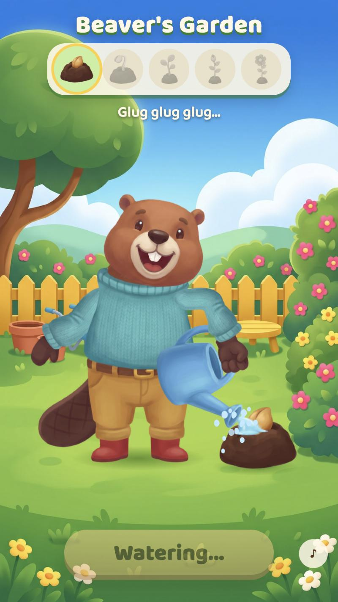
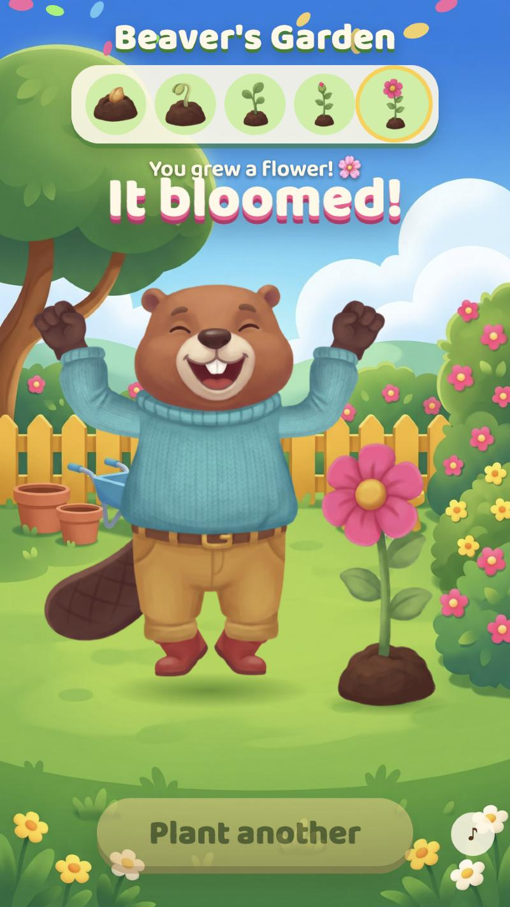

# Garden: the beaver plants a seed and waters it into a flower (2026-10-16)

Goal: one of our rigged characters, out on a lawn, plants a seed and waters it. Each watering grows the plant one
stage: seed, sprout, sapling, bud, flower. The result is played as a small tap-to-water game.

| Pouring (stage 1 → 2) | Bloom |
|---|---|
|  |  |

Rig frames (plant_seed, grow_0, water at three stages, grow_4): `frames_garden.png`.

## Play it
```
python3 -m http.server 8768 --directory experiments/2026-10-16-garden-grow/garden
```
Open `http://localhost:8768/game/index.html` (or the `garden-game` entry in `.claude/launch.json`).
- **Plant the seed:** the beaver squats and reaches; the rig's `seed` event pops the mound in.
- **Water it 1-4 / 4:** each `water` fires `pour` as the stream appears, and 0.9 s later the plant grows a stage, with sparkles and splashes.
- **Bloom:** after the fourth watering the beaver plays `cheer_jump` under falling petals; then "Plant another".

Track 0 is the beaver. Track 1 holds the plant stage (`grow_<n>`), so the plant keeps its stage whatever the beaver plays.

## Art: 4 Nano Banana Pro calls, all first pass except one re-roll (`scripts/gen_art.sh`, `prompts/`)
- **Props pair** (`props-pair.txt`): a sky-blue watering can, side view with the spout right, and one connected water stream.
- **Plant stages** (`prompts/plant-stages.txt`, 16:9): five stages on the same soil mound and baseline. Every stage fits as a swap.
- **Lawn** (`lr-render` block verbatim + `prompts/lawn-scene.txt`, 9:16): a back-garden lawn whose middle third is left open for the character and the plant.
- **Look heads** (`prompts/heads-look.txt`): two expression heads with the eyes on the plant (`look`, `look_happy`), made from the neutral head as image_1.
  - The first roll turned the whole head three-quarters, which would pop on the swap.
  - The re-roll says "the head does not turn ... only the pupils move", and came back front-on with the outline matching.
  - The heads are boxed to the neutral head and added to a garden copy of the beaver annotations (`garden/annotations.json`).

## Rig (pipeline changes, `plugin/skills/skipbo-art/scripts/`)
- **rig_props:**
  - A ground prop takes `x` (to the viewer's right) and `behind` (drawn behind the character).
  - `stages`: images that replace each other on one slot, each scaled so its mound is `width` wide.
  - `kind: attached`: a prop hanging at a point of another prop's image (`on`, `at`, `top`), kept upright (`inherit: noRotationOrReflection`). This is the stream on the spout; its length while pouring is `fall`.
  - `use` reserves a prop for the garden moves.
- **rig_anim:** `plant_seed`, `water`, `grow_0..N`, plus Spine events `seed` and `pour` (written to the skeleton by rig_output).
- **spine_qa:**
  - The upright stream is not stitched to its spout like a joint.
  - Jerks are judged only over the frames a bone draws in, so a stream that appears mid-move isn't judged on frames where it's hidden.
- **`scripts/fit_garden.py`** places the plant from the built pose: it reads where the stream starts mid-pour, puts the stem 7.5% of body height to the right of the landing point, and sets `fall` so the stream ends on the mound. `garden/rebuild.sh` builds, fits, rebuilds and runs QA.

## Review round (user): "the hand only sits on the handle; the tipped can goes behind the torso; have them look at the plant"
| Problem | Cause | Fix |
|---|---|---|
| Paw rests on the handle instead of holding it | The paw pointed along the handle, so nothing crossed the fingers | Forearm angled down, paw straight on it: the handle crosses the closed fist |
| Mid-pour the handle ran along the fingers | The can turned 72° under a fist that didn't | The forearm rolls with the pour (55% of the tilt) |
| Can behind the sweater and over the trousers mid-pour | The held prop's slot sits just behind the hand, and the beaver's arm slots are behind the torso; a tipping can swings its body toward the character | `front_of_body`: arm, can and stream drawn above the torso, below the head, for the whole move |
| Beaver stares at the camera | No head looked anywhere else | `look` / `look_happy` heads; head tilted 9° (water) / 8° (plant_seed) toward the plant, torso 3-4° |
| Paw spilling 20-33% past the cuff | A wrist bent 60-70° off the forearm | Paw kept straight on the forearm (above); plant_seed keeps squat's balance arm |
| Stream short of the soil, or into the leaves | Plant placed and stream length set by eye | `fit_garden.py` |

## QA
`spine_qa`: 23 of 25 checks pass, including every new move. Two checks fail by a hair, and both look clean in close crops:
- **seams:** the can's edge over the sweater scores 0.101 (limit 0.10).
- **sockets:** the reaching paw in `plant_seed` spills 0.042 (limit 0.03) as the arm comes back up.

Tests: `tests/test_props.py` adds the staged plant, the hanging stream, the events and the draw order, and checks that the garden moves pass `spine_qa` on the synthetic character.

## Not done
- A walk to the spot: the beaver plants and waters in place, beside the mound.
- The seed itself isn't drawn in the paw. The mound with its seed appears on the `seed` event.
- No sound files: the game uses small synthesized cues.
