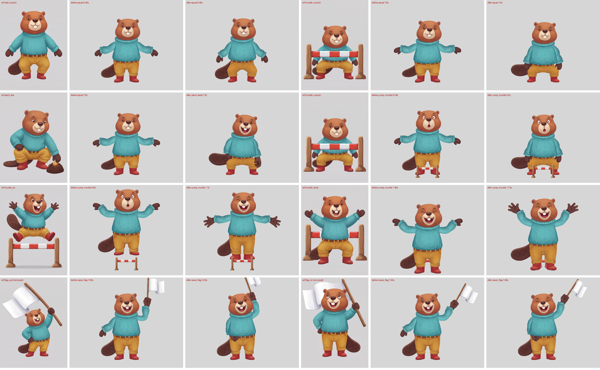

# Key-pose references: show the rig the pose it has to reach (2026-10-16)

**Question.** New poses come out stretched and lifeless (the garden squat, the hurdle jump, the flag wave). Is the
problem the rig, or that nothing tells it what the pose should look like? If Nano Banana Pro paints the approved
master *in* the pose, can we rig toward that?

**Answer: yes, and it changes what the rig is built from.** The references showed straight away why no amount of
bone tuning could fix the squat: the beaver has one trousers piece and no knees, so a squat could only squash the
trousers. The references supply the missing drawings (bent legs, a crouch, legs tucked in the air) as well as the
targets: how low, where the arms go, where the eyes look. With them, `squat`, `plant_seed` and `jump_hurdle` read like
the references; `wave_flag` improved less (see below).

Motion: `results/squat.gif`, `results/plant_seed.gif`, `results/jump_hurdle.gif`, `results/wave_flag.gif` (before
on the left, after on the right).

**Current pick (review 2026-10-17): the box-matched hybrid, `rig_hybrid2/` (section 2e).** Bones carry the motion; the held painting takes over at the holds, stretched to the mesh's outline box while the two overlap and eased to its own size after. It reads as continuous. The per-vertex morph (2f) measures a smaller halo, but its mid-morph frames break up (white gaps, torn cloth), so it needs more work before it can replace the box-matched one.

## 1. Key-pose references from the master

New prompt `references/prompts/spine/keypose.txt` (Nano Banana Pro). Its inputs:

- **Images:** `image_1` is the approved master; `image_2` is an optional prop already painted for the game.
- **Story** (`WHAT IS HAPPENING`): the action and its purpose. "Not exercising: bends down gently, the way a gardener does, to press the seed in" gives a different crouch from "squat".
- **Pose:** the single held moment.
- **Camera paragraph:** front view only.
- **Placement:** same scale, same ground line.

Nine frames in `refs/` (beaver), per action:

| Action | Frames | Story / purpose |
|---|---|---|
| Planting | `plant_mid`, `plant_low` | planting a seed, not exercising |
| Hurdle jump | `hurdle_crouch`, `hurdle_air`, `hurdle_land` | crouch, top of the jump above the bar, landing |
| Flag wave | `flag_out`, `flag_in` | the two ends of the swing |
| Squat in-between | `half_crouch` | the drawing halfway down |

Contact sheet: `results/keyposes_final.jpg`.

**What it took (15 Nano Banana Pro calls, the workflow test's 3 included):**

- **The body turned.** Round 1's crouch was a good pose in three-quarter view, which breaks the front-view rig. Fixed with a camera paragraph: "a 2D game character only ever drawn from the front, like a paper puppet: nose in the exact middle, both ears at the same height, chest and buckle square to the viewer; the head may tip and the eyes may glance, but nothing rotates".
- **The knees didn't bend.** Round 1's crouches kept straight legs. The model keeps the head where it is in the master and squeezes the legs about 24%. Fixed by measuring the drop:
  - "measured from the boot soles, the belt is now only half as high as in image_1";
  - "the head moves down with it, leaving a band of empty background above the ears";
  - "not painted smaller; only the legs fold";
  - "the thighs run almost level, the shins straight down".

  Then all three crouches came back right on the first try.
- **"Halfway down" bends the knees but doesn't shorten the legs.** Measured buckle to soles over belt width: rest 0.92, `half_crouch` 0.94, crouch 0.72, tuck 0.56. The half drawing works as the in-between because the swap splits the height change across both drawings.
- **The flag was held in the wrong paw.** The model put it in the paw on the picture's left in both flag frames, though the prompt said right. The character is symmetric, so those frames are mirrored for reading.
- **Scale drifts a little** (the flag frames zoom out). Everything is normalised by the belt's width along its row, which stays within 4% across all the frames.

## 2. Bridging the rig to the references (`scripts/kp_rig.py`)

An experiment-local post-process of the beaver rig (`../2026-10-15-beaver-jev-hands/beaver/rig`) into `rig_kp/`. Other animations are untouched, and drawOrder keys are remapped onto the new slot list.

- **Whole-legs drawings:** belt, trousers and boots as one drawing, in a new `legs` slot on a `legs` bone at the rig's own buckle (world-upright). While one shows, the rig's trousers and boots are hidden. They come from two in-between sheets (section 2a), not from the key-pose frames.
- **Swaps don't pop** (section 2a): the drawing shown follows a smooth progress curve, the legs' height follows a smooth curve through the drawings' heights, and each drawing is squashed or stretched to it by at most about 10%.
  - On the ground the hips drop by exactly the lost height, so the soles stay put.
  - In the air the body rides its own arc and the legs fold under it.
- **Targets read off the references:**

  | Animation | From the references |
  |---|---|
  | crouch | arms down beside the knees |
  | plant | working arm down and out to the soil, other paw on the knee, eyes down |
  | jump apex | arms flung up (upper arm 45°, forearm 62°) |
  | landing | arms out at shoulder height |
  | flag | arm raised high, the other paw on the hip |
  | crouch (tail) | the tail lies out flat behind |

- **Flag:** split into a stick and a cloth on its own bone at the hinge, which lags the swing and flutters.
- **Timing came from QA, not taste:**
  - the jump needed a held crouch before take-off and a longer landing absorb (2.9 s, not 2.2), and an arm swing spread a little past the apex, or `spine_qa` flags the body and hands as jerky;
  - the body must ride the jump arc and not the legs' height in the air, or tucking the legs pulls the body down.

**QA:** `spine_qa` passes all 21 checks on every animation of `rig_kp` (`./rebuild.sh`). Setup IoU is unchanged at 0.916, and the torso/tail seam is 0.014.

### 2a. Transitions between drawings (second pass)

The first build swapped between four legs drawings cut from separately generated key-pose frames, and the swaps looked glitchy:

- **Paint changed at every swap:** each frame was its own generation, so width, shade and saturation jumped.
- **Steps were too big:** half to crouch went from barely bent to fully splayed in one frame.
- **A pop at frame 0:** the rig's generated trousers swapped to the master's painted legs.
- **A light gap under the hem:** the colour cut left a notch in one drawing's belt.

What fixed it:

1. **One sheet per movement, painted together** (`prompts/legs-inbetweens.txt`, one Nano Banana Pro call each):
   - `squat`: stand → deep crouch, 5 drawings;
   - `jump`: stand → push-off → tuck, 5 drawings.

   One call means one paint job: same colours, light and belt; only the bend changes. Three things in the prompt mattered:
   - **Drawing 1 is the rig's own rest legs.** `image_3` is `legs/rig_rest_grey.png`, rendered from the rig by `scripts/render_rest_legs.py`. Without it the model painted lanky legs (legs height over belt width 1.6–1.9 against the rig's 0.91).
   - **Each drawing's height in numbers** ("drawing 3 four fifths of drawing 1…"). Otherwise the knees spread but the legs never shorten.
   - **No "empty band above"** wording: it invited faint ghost copies. The cutter keeps only shapes with boots in them, which drops any ghosts that still appear.

   Sheets: `refs/legs_sheet_{squat,jump}.png`. Cut and colour-matched to the rig's trousers and boots: `legs/{squat,jump}_{1..5}.png` (`scripts/cut_sheet.py`).
2. **One scale per sheet,** fitted so drawing 1 covers the rig's rest trousers and boots exactly. A per-drawing scale from the measured belt width would flicker by up to 15%.
3. **The rig's own parts stay on screen until the first swap,** since drawing 1 of each sheet is the rest pose. Animations no longer pop when they start.
4. **Progress drives the drawing** (`Bridge.leg_track`):
   - Each sheet has a progress p (0 standing, 1 full crouch or tuck), keyed with holds. The drawing shown is the nearest in p, so swaps fall at even steps (rest, 3, 4, 5 on the squat; rest, 2, 3, 4, 5 on the jump).
   - The height is a Catmull-Rom curve over p through the drawings' heights, and the shown drawing is squashed or stretched to it. On the beaver that's 0.90–1.08.
   - The jump switches sheets only at p = 0, where both show the rest legs at the same height.
5. **The belt band is filled solid** edge to edge in the cut (`cut_legs.py`).

### 2b. Transitions, third pass: in-betweens where the steps were big, and cross-fades

Even with matched paint, swaps still read as glitches in three places: the snap into the deepest crouch (the biggest step, about 20% of leg height), the jump's take-off and landing, and a small pop at every swap.

1. **In-betweens where the steps were big.** Repainting the sheets with 8 drawings failed twice:
   - in one 21:9 row the model made the legs lanky or wrapped them into rows;
   - in two rows of four, the squat sheet's paint drifted (dark edges, a silver buckle) and the jump sheet's order wandered.

   What worked is how an animator in-betweens. Two finished drawings A and B go in, and one call paints "A exactly, the in-between, B exactly" (`prompts/legs-midpoint.txt`), so the new drawing can only match their paint. `scripts/cut_mid.py` scales it by the copies' belts and declares its height halfway between A and B: the model gets the shape halfway but not reliably the height.

   Four calls added squat 3–4 and 4–5, and jump 2–3 and 3–4. The squat now runs rest, 3, 3½, 4, 4½, 5; the jump runs rest, 2, 2½, 3, 3½, 4, 5.
2. **Cross-fade at every swap** (`Bridge.cross_fade`). Two legs slots, `legs_a` and `legs_b`, each on its own bone; successive drawings alternate between them.
   - At a swap the incoming drawing fades in over 2 frames, then the outgoing one fades out over 2 frames (Spine `rgba` slot keys). One drawing is always opaque, so the background never shows through.
   - Each bone keeps its drawing at the legs' height, so the two overlap exactly.
   - The rig's own trousers and boots fade the same way at the first and last swap.
   - Fades shorten when swaps come close together.
3. **Retimed jump.** The more even jump sheet let the take-off drop its extra key: progress eases from standing to the tuck and passes through the push-off on its own. The landing reach-down hands over to the ground a little later.

**Measured** (`scripts/pops.py`). This is the share of lower-body pixels that change at a swap frame, beyond the frames around it. `rig_prev` is the second pass rebuilt with `KP_PREV=1`.

| | worst swap, before | worst swap, now | average swap, before | average swap, now |
|---|---|---|---|---|
| squat | 2.61% | 1.12% | 0.78% | 0.07% |
| plant_seed | 3.41% | 0.95% | 2.51% | 0.07% |
| jump_hurdle | 4.37% | 2.47% | 1.73% | 0.19% |

The swap frames no longer stand out from the motion around them. `spine_qa` passes all 21 checks; it ignores slot alpha, so it sees both drawings fully opaque during a fade, the stricter case.

The GIFs (`results/*.gif`, and against the second pass in `results/vs_prev/`) use `scripts/render_alpha.py`: spine_qa's renderer plus slot alpha, which the Spine player applies anyway. `results/swaps_crossfade_zoom.png` shows each frame of a squat at the belt. For one or two frames a fade shows faint edges of the outgoing drawing, which reads like motion blur.

### 2c. Skeleton-driven legs instead of drawing swaps (fourth pass, `KP_LEGS=bones` → `rig_bones/`)

After the third pass the legs still stepped, holding each drawing 3 to 5 frames (6–10 fps against a 30 fps body), and the landing flickered through three paintings in 6 frames. So this pass takes only the skeleton from the drawings and bends the rig's own trousers painting with bones.

- **Joints** (`scripts/leg_joints.py` → `legs/joints.json`, overlay `legs/joints.png`). Per drawing and leg: hip, knee, ankle and sole.
  - The hip is fixed on the belt.
  - The knee is the leg's outer bulge, set in by half the cuff's thickness. Seen from the front, a crouch's thighs run out sideways, so tracing the leg's centre line from the crotch missed them.
  - Standing and push-off are marked straight, because their wide hips read as a bulge.
  - The ankle and sole come from each red boot.
- **Bones and mesh** (`scripts/leg_bones.py`).
  - `thigh_<s>` and `shin_<s>` hang on the hips, appended at the end of the bone list.
  - The trousers painting becomes a 36 px grid mesh, weighted hips → thigh → shin with wide blend bands. Narrow bands crumpled the cloth at the knee into shards. A soft band down the middle lets the crotch stretch.
  - At rest the mesh reproduces the region attachment, so swapping it in at frame 0 changes nothing.
  - The boots keep their bones and follow the ankles, turned with the ankle → sole direction.
  - The hips drop so the soles stay on the ground.
- **Key poses only.** The joints run through squat rest → ¾ crouch → deep crouch and jump rest → mid-fold → tuck. Feeding every in-between's joints made the knees zig-zag, since the drawings' joints don't line up exactly.

**Result** (`results/bones_vs_drawings/`: drawing swaps on the left, bones on the right; `keyposes.png` puts them beside the references):
- The legs move continuously at 30 fps, with no swaps, no stepping and no landing flicker.
- They reach the references' silhouettes: knees out, low crouch, tuck in the air.
- The painted knee folds can't appear, since one painting is bent.
- The cloth shows some jagged edges at the knee mid-bend, and the tuck is boxier than the drawing.
- `spine_qa` fails the three leg animations on several checks: `detached`, `joint_holes`, `unstitched`, `occluded`, `mesh_fold` and `jerky_bones`. The console line cuts each result at 300 characters, which first hid all but `detached`; the full results are in `rig_bones/qa/report.json`.
  - Most of these are the checks not knowing a weighted mesh owns the legs: the boots and shins count as detached on every frame, frame 0 included.
  - `jerky_bones` is real:
    - thighs turn up to 12.7°/frame² on the jump (limit 4) and 5–6.5° on the squat and plant;
    - knees and boots on the jump reach 0.016–0.021 body heights/frame² (limit 0.012).

### 2d. Hybrid: bones carry the motion, painted drawings at the holds (`KP_LEGS=bones KP_HYBRID=1` → `rig_hybrid/`)

The bones-only legs moved continuously but showed no painted folds and a jagged knee mid-bend. In the hybrid (`LegBones.hybrid`), the painted drawing of a held key pose takes over while it is held: the crouch before take-off, the squat and planting crouch, the landing absorb (`s5`) and the top of the jump (`j5`).

- **Fade in:** as the legs' progress nears the key (`HOLD_IN`, p 0.84 → 0.95), the drawing fades in over the mesh in `legs_a`. It is stretched every frame to the bones' leg height, so its soles sit on the ground.
- **Swap underneath:** once the drawing is opaque, the mesh and the rig's own boots fade out beneath it (`MESH_OUT`, p 0.95 → 1). Leaving the hold, the reverse.
- **Alignment:** the bones' targets came from that drawing, so the silhouettes line up at the hand-over.
- **Jump top:** the bones version had no hold there, so the tuck now holds briefly (p = 1 from 1.36 to 1.46 s).

**Result** (`results/hybrid/`: drawing swaps against the hybrid; `results/hybrid/vs_bones/`: bones only against the hybrid; `results/hybrid_holds_zoom.png`: each hand-over frame by frame):
- The legs move continuously between the poses with no stepping, and the holds show the real painted folds.
- The hand-overs don't pop (`pops.py`): the squat's two change the picture no more than the frames around them, and the jump's worst is 1.53%, against 2.47% for the drawing swaps.
- For a frame or two at the tuck, the rig's boots show faintly below the drawing's boots while they fade out.
- `spine_qa`: everything passes except the same false-positive `detached` boots as the bones-only rig. The body and hands are under the jerk limit; the knee bones are over it at the jump's turns, as in the bones-only rig.

### 2e. Hand-overs between the bent mesh and the painting (fifth pass)

In the hybrid the two processes showed overlapped: at a hand-over the bent mesh and the painting are two outlines of different size (into the squat's crouch the mesh was about 7% wider and 19% taller), and fading between them shows both.

**Measured** (`scripts/halo.py`: the fading mesh's area outside the painting's outline, weighted by its opacity, as a share of the painting, summed over the hand-over frames):

| Hand-over | squat | jump_hurdle | |
|---|---|---|---|
| 2d as built | — | — | a bug: setting the mesh attachment overwrote its fade keys, so the trousers mesh never faded out under the painting |
| fade only, bug fixed (`rig_hybrid`) | 112% | 315% | |
| **painting box-matched to the mesh** (`rig_hybrid2`, `scripts/match_handover.py`) | **61%** | **202%** | while both show, the painting is stretched to the mesh's outline box; once the mesh is gone it eases to its own size over 0.25 s (and back before leaving) |
| painting skinned to the same bones (`rig_hybrid3`, `LegBones.key_mesh`) | 98% | 309% | the held painting is a mesh bound in its own pose, so it bends with the legs; hand-over at about two-thirds of the way in |
| the same, plus a fitted mesh size (`legs/hold_fit.json`, `scripts/fit_holds.py`, `KP_FIT=1`) | 95% | 301% | thigh and shin thickness, shin length and a knee nudge per held pose, fitted on overlap: 0.73 → 0.80 crouch, 0.75 → 0.80 tuck |

- **Box-matching** (the idea: match the sizes at the intersection, then take the painting to its own size) halves the halo. It can't match the shapes inside the box: the bent mesh's tuck is a wide blob, the painting's a diamond.
- **The skinned painting** stops the boots tearing at the cuffs (soft boot weights) and shows the painting exactly at the hold. It doesn't shrink the halo: in the same pose, the bent trousers are still fuller than the painting.
- **A few size knobs can't bend one standing painting into the crouch painting.**

What would remove the halo is a true morph: give each trouser-mesh vertex a skeleton coordinate (side, how far along the leg, how far across it), find the same coordinate in the held painting, and move the vertex there as the pose nears the hold (Spine deform keys). The outlines then coincide at the hand-over and only the paint changes. It needs deform timelines in the renderer too.

`results/handover/`: fade only against box-matched, and box-matched against the skinned painting, as GIFs; `results/hybrid3_handover.png` and `results/handover_matched_vs_fade.png` show the hand-over frames.

### 2f. Per-vertex morph at the hand-overs (sixth pass, `KP_MORPH=1` → `rig_morph/`)

Built on the plain-painting hybrid (2d). As the legs near a held pose, the trousers mesh morphs into the held painting's outline, and the rig's boots onto the painting's boots, so at the hand-over the two coincide and only the paint changes.

- **Correspondence through the skeleton** (`LegBones.morph_targets`).
  - Control points sit along both outlines at the same skeleton coordinates (along the hip → knee → ankle chain, across at the outline on each side and on the chain), plus the belt, which keeps its place.
  - Bent-mesh side: the held pose's joints and the standing legs' widths (the bones keep a leg's thickness).
  - Painting side: its own joints and widths, measured on the trousers only; boots excluded, or the cuffs get pulled out to boot width.
  - A thin-plate spline through them gives each mesh point a correction: a displacement from where the bones put it at the held pose to the painting.
- **The bones do the bending; the spline only the remaining shape.** Two earlier versions tore the cloth into shards mid-morph:
  - mapping each point by its own skeleton coordinate split neighbours across the knee corner and the crotch;
  - a spline from the standing legs straight to the crouch painting has to bend 90° and folds.
- **Deform keys:** each frame the correction, scaled by m = smoothstep(0.25, 0.84, progress), is written as Spine deform keys on the trousers mesh, as offsets in each influencing bone's bind space. It is complete before the painting starts to fade in at 0.84.
- **Boots** (`LegBones.boot_fit`). About half the leftover halo was the rig's separate boots. Each is eased onto the painting's boot by a similarity about its centre (shift, turn by principal axes, scale by area) over the same ramp.
- **Renderer:** `scripts/render_alpha.py` applies deform keys (spine_qa doesn't), and `halo.py` measures with them.

**Measured** (halo summed over the hand-over frames, worst frame in brackets):

| | squat | jump_hurdle (3 hand-overs) |
|---|---|---|
| fade only | 112% (26%) | 315% (27%) |
| box-matched painting | 61% (14%) | 202% (24%) |
| morph, trousers only | 45% (10%) | 145% (17%) |
| **morph, trousers and boots** | **26% (6%)** | **95% (13%)** |

A tighter spline (smoothing 5–50, 11–16 samples per leg) changed nothing.

`results/morph/`: box-matched against the morph; `results/morph/vs_swaps/`: drawing swaps against the morph; `results/morph_handover.png`: each hand-over frame.

**What remains:**
- the squat shows a faint pink rim under the boots for one frame;
- the jump's take-off fold still creases mid-motion (1.23–1.27 s), which is the bones bending one painting, not the hand-over;
- the boots jerk a little on the landing's reach-down: 0.019 against spine_qa's 0.012 by `jerk.py`; the bones-only rig had 0.016 there;
- spine_qa passes 18/21; the three failures are the false-positive `detached` boots of 2c.

## What didn't work as well

- **`wave_flag`:** the arm is up and the other paw is on the hip, but the references' big streaming cloth isn't there.
  - The cloth only rotates about 5° before a gap opens at the stick.
  - A real fix needs a mesh cloth weighted to the stick, or two or three cloth drawings swapped like the legs (cloth out, cloth over); the same keypose prompt can paint them.
- **Torso compression:** the references also shorten the sweater in a crouch (a hunch). The rig can't: the torso's scale would squash the head. The crouch therefore reads a little taller than the reference.
- **The push-off drawing barely rises onto the toes** (jump sheet drawing 2). It shows for about 3 frames, so it reads, but a stronger push-off would help the take-off.

## 3. ComfyUI workflow: **SKIPBO - Master key poses (Nano Banana Pro)**

Published to the server 2026-10-16. It's built by `tools/build_keypose_workflow.py`, which also writes the agent template `templates/keyposes.api.json` (`comfy.py run keyposes …`).

**Inputs:**
- the master, and an optional prop (bypass it if there isn't one);
- editable boxes: CHARACTER NOTES, WHAT IS HAPPENING, PROP ROLE, PLACEMENT, CHECK;
- three KEY A/B/C pose boxes, one per key frame.

**Output:** three Nano Banana Pro calls, saved as `key_A`, `key_B`, `key_C`.

The canvas example is the beaver hurdle jump, and the how-to note carries the lessons above. Tested end to end on the server (`runs/kp-workflow-test/`: crouch, air, landing).

`tools/build_spine_workflow.py`'s `to_ui` now takes its layout as arguments; its own output is byte-identical.

## Files

| Path | What |
|---|---|
| `prompts/keyposes.env` | story, pose, placement and check text per frame (beaver) |
| `scripts/gen_keyposes.sh` | the reference calls (`gen_keyposes.sh plant_low …`) |
| `prompts/legs-inbetweens.txt`, `legs-midpoint.txt` | the in-between sheet prompt (move, steps with heights, rest legs as drawing 1); one in-between from two drawings |
| `scripts/cut_legs.py`, `cut_sheet.py`, `cut_mid.py`, `render_rest_legs.py` | legs drawing out of an image (belt / sole metrics); sheet → drawings, colour-matched; in-between → drawing; the rig's rest legs as an image |
| `scripts/leg_joints.py`, `leg_bones.py` (+ `halo.py`, `match_handover.py`, `fit_holds.py`) | skeleton targets from the drawings; leg bones + weighted trousers mesh driven by them (`KP_LEGS=bones`), with painted drawings at the holds (`KP_HYBRID=1`) |
| `scripts/render_alpha.py`, `pops.py`, `gen_legs_sheets.sh` | renderer with slot alpha; swap-pop measure; the 8-drawing sheets that didn't work |
| `scripts/kp_rig.py` | the bridge: legs slot, cloth bone, the four animations |
| `scripts/compare.py`, `before_after.py`, `jerk.py` | reference vs rig sheet, before/after GIFs, quick smoothness check |
| `rebuild.sh` | cut, build, QA, render |
| `refs/`, `legs/`, `rig_kp/`, `results/` | outputs |

## Next

1. **Make whole-legs pose variants a first-class rig part.** Fold them into `spine_rig.py` and `rig_anim.py` (a `legs` variant set like the hand variants, and a legs plan in `squat`, `jump_hurdle` and `plant_seed`). That waits until the plant-growth session's uncommitted `rig_anim.py` changes land, since this experiment stayed out of those files.
2. **Use the in-between sheets as the house way to make legs variants:** the key-pose frame as `image_2` (the target) and the rig's rendered rest legs as `image_3` (drawing 1).
3. **Flag cloth as two or three swapped drawings.**
4. **Run key poses for every new animation before rigging it,** and review the rig against them with `compare.py`.
