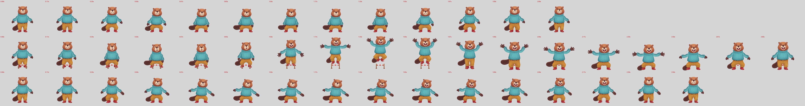

# Whole-legs sheets as a rig part (2026-10-16)

**Question.** The key-pose experiment (`../2026-10-16-keypose-refs`) bent the beaver's knees with a post-process
(`kp_rig.py`) on one built rig. Its third pass (section 2b) uses:
- in-between sheets driven by progress;
- midpoint in-betweens where the steps were big;
- a cross-fade at every swap.

Can the rig pipeline do the same for every character, from annotated drawings, the way it does hand variants?

**Answer: yes.** A character with legs sheets now gets bent-knee squats, plant_seed crouches and tucked jumps from
`spine_rig.py` itself. A legs sheet is drawings of belt, trousers and boots, painted together in one call per movement.
A character without them keeps the old squat (the hips squash) and jump.

- **Beaver**, built from the key-pose experiment's two cut sheets and four in-betweens: `spine_qa` passes 20/20
  (`beaver/qa.txt`). Swap pops (`pops.txt`, kp's `scripts/pops.py`) are at or below kp_rig's (`pops_kp.txt`):

  | | worst swap | average swap | kp_rig worst | kp_rig average |
  |---|---|---|---|---|
  | squat | 0.65% | 0.05% | 1.12% | 0.07% |
  | jump_hurdle | 1.95% | −0.04% | 2.47% | 0.19% |
  | plant_seed (garden beaver) | 1.65% | 0.10% | 0.95% | 0.07% |

  The plant_seed rows aren't like for like: the garden beaver's plant_seed is the plant-growth session's, timed for
  the garden props, while kp_rig has its own.
- **Beaver with the garden props**: squat, plant_seed and water pass (`beaver_garden/qa.txt`). Its one failing check,
  the seam of the can over the torso (0.101), is the same in the garden experiment's own rig, so it isn't the legs'.
- **Fox and moose**: the rebuild is byte-identical to the code before this change, and passes 18/18.



## What changed in the pipeline

- **Annotations** (`rig_annotations.py`): a new role `legs`.
  - The name must be `legs`. The variant is `<sheet>_<n>`, with sheet `squat` or `jump` and n counted from 1, left to
    right; drawing 1 is the rest legs. An in-between is `<sheet>_<a>-<b>`, with b = a + 1.
  - Two points: `waist`, the middle of the belt where the master's waist point sits on the master's belt; and
    `ground`, the soles' line midway between the feet.
  - A drawing that adds nothing is `ignored`.
- **Placement** (`rig_variants.add_legs`, called by `spine_rig.py` at stage 4b):
  - two slots, `legs_a` and `legs_b`, just above the trousers and hidden at rest;
  - each slot on a bone of its own, child of the hips at the master's waist, world-upright. The bones are **appended
    after every other bone**: weighted sleeve meshes name their bones by index, and a test checks that every old bone
    keeps its index;
  - **one scale per sheet**, fitted so drawing 1 covers the rig's own rest trousers and feet: as wide at the waist, as
    tall from the waist to the lowest sole;
  - an in-between's height declared halfway between its two drawings', and its drawing squashed to it. kp_rig
    declares the height but draws the image at the sheet scale, which leaves its soles off by the difference;
  - the doubt `legs_aspect`, for a sheet that has to stretch more than 12% one way to fit.
- **Moves** (`rig_anim.leg_track`, `cross_fade`), ported from kp_rig's `Bridge.leg_track` and `Bridge.cross_fade`:
  - Each sheet has a progress p (0 standing, 1 full crouch or tuck), keyed with holds. The drawing shown is the nearest
    in p along the sheet's sequence: the rig's own parts, then drawing 2, 3 and on, with the in-betweens in their places.
  - The legs' height is a Catmull-Rom curve over p through the drawings' heights; each slot's bone scales its drawing
    to it. On the ground the hips drop by the height lost, so the soles stay put. The tail lies out flat as the body sinks.
  - **Every swap cross-fades.** Drawings alternate between the two slots. The incoming one fades in over 2 frames
    before the swap, then the outgoing one fades out over 2 frames (Spine `rgba` slot keys). The rig's own trousers and
    feet fade the same way, and `rig_slots.sync_worn` gives a worn boot's back slot its shell's fades.
  - Timing and segments are kp_rig's: `squat` 2 s; `jump_hurdle` 2.9 s with the third pass's keys (the jump segment
    `(1.02, 0), (apex, 1), (1.4, 1), (1.74, 0)`, the landing from 1.74 s, air easing out over 1.56–1.94 s);
    `plant_seed` uses `crouch_legs` in place of `squash_hips`.
- **spine_qa** already draws slot alpha (`qa_constraints.slot_color`, from the Spine Pro work). It now judges a slot
  part-way through a fade by its whole drawing, as at full alpha. A slot faded to nothing counts as hidden. Before, a
  fading drawing's mask was cut at half alpha, so mid-fade it read as detached from its parent.
- **Prompts**: `references/prompts/spine/legs-inbetweens.txt` and `legs-midpoint.txt`, kp's prompts with the beaver's
  costume words taken out. `scripts/rig_rest_legs.py` renders the in-betweens prompt's image_3, the rig's own rest legs.

## Where the port differs from kp_rig, and why

kp_rig passes on the beaver. On the synthetic test character, whose legs are half its height, three things jerked
(`spine_qa` jerky_bones up to 0.025 against 0.012):

1. **The jump sheet moved the hips in the air.** Its fold (and its push-off drawing passing again on the way down) moved
   the hips while the body landed. It now lifts the hips only with the push-off, on the way up, through a smooth max.
2. **My `catmull` halved the Catmull-Rom slopes,** which put sharp bends just past each knot. kp's slopes were right;
   mine are fixed.
3. **The height over p was flat at the full crouch,** on top of the flat progress hold, so rising out of a crouch
   started slowly, then lurched. The height curve now leaves its end knots along the end segment.

4. **In-betweens halved the legs' speed in their interval** when every drawing sat evenly spaced in p. The drawings
   now sit halfway between evenly spaced and spaced by height change (`legs_spacing`). Spaced by height alone, two
   drawings of about the same height would flash past in a frame.

With these, the synthetic character passes even with deeper sheets than the beaver's (crouch 0.70, tuck 0.60 of rest).

## Beaver builds

`make_beaver_legs.py` writes two annotation files. Both carry the beaver's annotations, with output files referenced
in place, plus fourteen legs pieces, also referenced in place: the key-pose experiment's cut sheets
`../2026-10-16-keypose-refs/legs/{squat,jump}_{1..5}.png`, and its in-betweens `squat_34`, `squat_45`, `jump_23` and
`jump_34`, annotated as `squat_3-4` and so on. Waist and ground come from `cut_sheet.py`'s metrics, and `squat_2` is ignored, as kp_rig's
sequence skips it.

- `beaver/`: with the flag and hurdle props.
- `beaver_garden/`: from the garden experiment's copy, with its `look` heads, plus the garden props.

```bash
uv run --with pillow python make_beaver_legs.py
uv run ../../plugin/skills/skipbo-art/scripts/spine_rig.py --master ../2026-10-15-beaver-jev-hands/beaver/beaver_master.png --annotations beaver/annotations.json --props ../2026-10-15-beaver-jev-hands/beaver/props.json --out beaver/rig
uv run ../../plugin/skills/skipbo-art/scripts/spine_rig.py --master ../2026-10-15-beaver-jev-hands/beaver/beaver_master.png --annotations beaver_garden/annotations.json --props ../2026-10-16-garden-grow/garden/props.json --out beaver_garden/rig
```

- **Heights** (waist to soles, units): squat rig 447, then 443, 427, 411, 372, 333; jump rig 447, then 487, 459,
  431, 401, 371, 373.
- **One doubt:** `legs_jump_1` `legs_aspect` x0.77. The jump sheet was painted lankier than the rig's legs; kp_rig's
  fit stretches it the same way (0.70 tall against 0.89 wide).

Motion: `beaver/rig/qa/squat.gif`, `beaver/rig/qa/jump_hurdle.gif`, `beaver_garden/rig/qa/plant_seed.gif` (spine_qa's
renderer, with slot alpha).

## Fox and moose

Rebuilt from `../2026-10-11-rig-annotations/{fox,moose}/annotations.json` with this code, and with the code before it
(the plant-growth snapshot). The skeleton JSON is byte-identical: they have no legs pieces, so nothing changes.
`spine_qa` passes 18/18 for each (`qa_fox.txt`, `qa_moose.txt`). Their rigs aren't re-committed.

## Tests

`tests/test_legs.py`, on the synthetic character (`make_character(legs=True)`: a squat sheet and a jump sheet, five
drawings each, plus one in-between each, painted 4% short so the squash to the declared height is tested):

- validation;
- bone order and slot;
- one scale per sheet;
- the squat starting from the rig's own parts, through every drawing and in-between;
- one drawing always opaque, and the swaps fading;
- both drawings of a cross-fade standing on the ground every frame;
- the jump's tuck clearing the bar;
- `spine_qa` on squat and jump;
- plant_seed on the squat sheet;
- the fallback without legs;
- the rest-legs render;
- both prompts lint.

## Next

1. Fold the legs sheets into the beaver's own `draft_annotations.py` and rebuild its canonical rig.
2. Fox and moose need key poses and two legs sheets each before their squats bend.
3. kp's `cut_sheet.py` colour-matches each drawing to the rig's trousers and boots by the beaver's colour classes. A
   general version, matching to each rig's own parts, would make the swap from the rig's parts seamless for any
   character.
