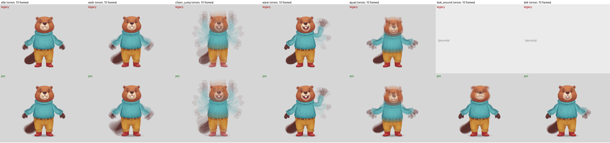

# Spine Pro rigs (2026-10-16)

**Problem:** our rigs look stiff. Every part is a rigid image on one bone, the root is the motion bone, and nothing
follows through. The [Armanimation study](../../docs/research/armanimation-spine/README.md) (§4) listed the Spine
primitives professional animators use that we skip.

**Goal:** emit those primitives from what we already build, keep QA honest about them, prove the files play the same
in the official Spine 4.2 runtime, and give the animator a project they can fix plus a diff that turns their fixes
into labelled data.

**Verdict.**
- `scripts/spine_pro.py` upgrades any built rig in about 2 s and never touches the legacy folder. 8 of the 8 planned
  features ship; planted feet use transform constraints, not IK, on our cast (they have no leg bones).
- The motion is visibly looser: tails swing and settle after jumps and walks, ears flop, the chest breathes in every
  animation, the face turns in `look_around`. The setup pose is unchanged.
- **Runtime match.** Every pose spine_qa renders matches `@esotericsoftware/spine-player@4.2.120`: 156 pro poses and
  140 legacy poses across the three characters, plus the synthetic character's leg-IK rig, with no console errors. The largest gap is 0.0005 units on a bone and
  0.0007 units on an attachment's centre, i.e. rounding.
- **QA:** all three pro rigs pass every `spine_qa` check (beaver 22/22, fox 20/20, moose 20/20), including the new animations.

Onion skins (10 frames averaged; what moves blurs), legacy on top, pro below. Stills: `<char>/legacy_vs_pro.png`.
Fox and moose: `fox/legacy_vs_pro_onion.png`, `moose/legacy_vs_pro_onion.png`.

## What each primitive is

| # | Primitive | What the rig gets | Research | Status |
|---|---|---|---|---|
| 1 | Container | `character` bone under `root`; jump keys move onto it (a jump = every foot leaves the ground together), the hips keep the rest; `root` is never keyed. Soft ground `shadow` slot on its own bone outside the container, first in draw order, shrinking and fading with the jump height (slot `rgba` keys) | §2.4, §3 quadruped (shadow outside the container) | works |
| 2 | Underfill | `<slot>_under` for each moving part (sleeves, hands, head, tail, feet, hips): the part's silhouette, dilated by 0.4% of the body height **only around the joint with its parent** (hard edge), filled with the part's own colour bled outward and darkened to 78%. Regions copy the placement; meshes copy the weights. Attachment swaps are mirrored. Drawn as one block behind every part (above the shadow), so it shows only where a gap opens onto the background | §6 rule 2 | works, changed from the spec (see "What didn't work") |
| 3 | Tail chain | `tail > tail2 > tail3 (> tail4)` along the tail's medial axis (slice centroids of its alpha). The tail becomes a strip mesh, with rows perpendicular to the axis and a vertex row on every pivot. Weights are 100% on one bone, with a 12%-of-length smoothstep band at each joint and a rigid tip. The strip runs on the straight root-to-tip axis (regular quads that never fold), with a row through each pivot's projection. Pose variants (the fox's `tail_up`) stay rigid regions on `tail` | §2.5, §2.6, §3 quadruped | works |
| 4 | Chest + breathing | `chest` helper (yellow) at half the shoulder height; the torso becomes a mesh weighted torso -> chest. Arms, head and neckwear move under the chest with `inherit: noScale`, so the chest's breathing scale (1.2-2.2%) never scales them | §2.5 (hip/chest split; inherit-scale off for breathing) | works |
| 5 | Face + ears | Every head attachment (all 10 expressions) becomes a 9x9 grid mesh. The rim is weighted to `head_base` and the centre to a `face` helper, at most 45% with a smooth falloff. Moving `face` 3% of the body height turns the face (Arman's face3D). Ear lobes are found from the head's alpha: the highest column in each outer half with a valley at least 4% of the head deep between it and the crown. Each gets an `ear_l` / `ear_r` bone; a grid line runs through each ear pivot so the bone sits on a vertex. The moose's ears are separate parts already, so they are reused | §2.5 (`face`, ear chains), §3 | works (beaver, fox; bear on a test build) |
| 6 | Planted feet | A green `<foot>_ik` target under `character` per foot. The foot follows it through a transform constraint (translate + rotate, `mixScale*` 0). With a leg bone (the synthetic character), a one-bone IK (compress + stretch) aims the leg instead, plus a rotate-only transform. Every animation's foot motion is baked onto the targets from the legacy world pose, so walk / run / jumps are unchanged (test: feet within 0.6 units of legacy) while the hips bob over planted feet in the new idle | §2.7, §3 (targets from the container) | works; real 2-bone IK not used: the cast has no thigh/shin chain |
| 7 | Organisation | Controllers red, helpers (`chest`, `face`, `shadow`) yellow, targets green; consistent names; setup pose identical to legacy | §2.8 | works |
| 8 | Animations | New `idle` (2 s: breathing, hips bob and weight shift over planted feet, offset limb sways, a look through `face`, a blink), `look_around` (3.2 s, face carries the gaze, head tilts after it), `talk` (2.4 s, 7 mouth swaps, each with a jaw-like head squash; nod; one arm beat). On every animation: chest breathing, tail / ear / chest follow-through and tail / ear sway | §2.9 | works |

**Follow-through model** (`pro_motion.chain_overlap`). Each segment is a damped spring on its rotation relative to its
parent. Two things drive it: its pivot's acceleration (a moving root drags the tail) and its parent's angular
acceleration (inertia), plus the earlier segments' offsets, so the lag runs down the chain.
- Loops are simulated for three cycles and the seam closed (the pivot accelerations are smoothed over 3 frames).
- One-shots fade the offsets out over their last 0.3 s.
- A limiter keeps the added acceleration under 1.6°/frame², then re-measures the chain with spine_qa's own jerk
  formula and scales the overlap down until it passes with a margin.

Tail: 1.5 Hz, damping 0.35, ±11° per segment. Ears: 2.6 Hz, ±10°. Chest: ±4°. All keys are dense linear 30 fps keys,
like spine_rig's, so the jerk check sees exactly what the runtime plays.

## Before / after

`motion_stats.py`: bones that visibly move (0.3% of height or 1°), and how far the tail tip travels per second.

| character | animation | moving bones legacy | moving bones pro | tail tip travel legacy (H/s) | pro (H/s) |
|---|---|---|---|---|---|
| beaver | idle | 7/12 | 17/19 | 0.00 | 0.08 |
| beaver | wave | 4/12 | 11/19 | 0.00 | 0.08 |
| beaver | cheer_jump | 12/12 | 19/19 | 0.28 | 0.44 |
| beaver | walk | 12/12 | 19/19 | 0.17 | 0.56 |
| beaver | squat | 12/12 | 19/19 | 0.02 | 0.07 |
| beaver | look_around | - | 16/19 | - | 0.08 |
| beaver | talk | - | 11/19 | - | 0.05 |
| fox | idle | 7/12 | 17/19 | 0.00 | 0.06 |
| fox | wave | 4/12 | 11/19 | 0.00 | 0.07 |
| fox | cheer_jump | 12/12 | 19/19 | 0.14 | 0.41 |
| fox | walk | 12/12 | 19/19 | 0.14 | 0.42 |
| fox | squat | 12/12 | 19/19 | 0.03 | 0.07 |
| fox | look_around | - | 16/19 | - | 0.07 |
| fox | talk | - | 11/19 | - | 0.04 |
| moose | idle | 12/18 | 18/20 | - | - |
| moose | wave | 9/18 | 10/20 | - | - |
| moose | cheer_jump | 18/18 | 20/20 | - | - |
| moose | walk | 18/18 | 20/20 | - | - |
| moose | squat | 16/18 | 18/20 | - | - |
| moose | look_around | - | 17/20 | - | - |
| moose | talk | - | 10/20 | - | - |

Moving-bone counts include the new bones (chest, face, ears, tail chain), so read them with the totals. The story is in the gestures: in `wave` the legacy rig moves 4 of 12 bones and the pro rig 11 of 19 (tail, ears and chest join in), and the tail tip travels 2-3x further in walks and jumps. The moose has no tail; its separate ears and the chest carry its secondary motion. Full table: `uv run motion_stats.py beaver fox moose`.

## QA

| Character | Checks passed, pro | Checks passed, legacy | Setup IoU pro / legacy | Worst seam pro | Notes |
|---|---|---|---|---|---|
| beaver | **22/22** | 20/20 | 0.917 / 0.916 | 0.085 | 13 legacy + look_around, talk |
| fox | **20/20** | 18/18 | 0.897 / 0.897 | 0.011 | 11 legacy + look_around, talk |
| moose | **20/20** | 18/18 | 0.874 / 0.873 | 0.015 | 11 legacy + look_around, talk |

The pro QA reports are in `<char>/rig_pro/qa/` (gifs and strips per animation) with `qa_summary.txt`.

`spine_qa.py` was extended, not changed: `qa_constraints.py` holds the new evaluation and is only reached when a
skeleton uses `inherit`, `ik` or `transform`. Legacy rigs take the old code path (golden test and the full suite pass).
- **Bone inherit:** all five 4.2 modes, ported from spine-ts `Bone.updateWorldTransformWith`.
- **IK:** one-bone IK, `IkConstraint.apply1` (compress, stretch, uniform, mix).
- **Transform constraints:** absolute world, `applyAbsoluteWorld`.
- **Order:** constraints run in `order`, and each re-poses its constrained bones' descendants.
- **Slot colour:** setup colour and `rgba` timelines, multiplied into the layer.
- **Linked meshes:** resolved to a copy of their parent.
- **Decor slots** (`shadow`, `<slot>_under`) are drawn but not judged as parts, so joint, occlusion and seam checks
  still judge the real parts.

Two Spine details that bit, or would have:
- Transform constraints default `mixScaleX` and `mixShearY` to **1**: leaving them out snaps the foot's scale to the
  target's.
- A `linkedmesh` must live in the same slot as its parent, so an underfill in its own slot cannot link to its part's
  mesh. Underfills copy the mesh instead.

## Runtime check

`runtime_check/expected.py <rig.json>` writes spine_qa's poses (every bone's world matrix, every slot's active
attachment and the world centre of its vertices) at 0 / 30 / 60 / 100% of each animation.
`runtime_check/check.html?rig=<char>/rig_pro/<char>` loads the rig in the official player (4.2.120, pinned) and
compares. Serve this folder (`python3 -m http.server 8790`) and read `window.result`.

| Rig | Poses | Max bone error | Max attachment-centre error | Attachment mismatches | Console errors |
|---|---|---|---|---|---|
| beaver pro / legacy | 60 / 52 | 0.0005 / 0.0005 | 0.0007 / 0.0007 | 0 | 0 |
| fox pro / legacy | 52 / 44 | 0.0005 / 0.0005 | 0.0007 / 0.0007 | 0 | 0 |
| moose pro / legacy | 52 / 44 | 0.0005 / 0.0005 | 0.0007 / 0.0007 | 0 | 0 |
| synthetic pro (leg IK + rotate constraints) | 48 | 0.0005 | 0.0007 | 0 | 0 |

Errors are in Spine units (the characters are about 1,200-1,500 units tall). The rotation/scale part of the bone
error is scaled by 100. A frozen frame of the pro beaver in `preview.html` looks the same as spine_qa's render.

## What the animator gets

`<char>/rig_pro/`: `<name>.json` (Spine 4.2), `.atlas`, `images/`, `preview.html` (pinned 4.2.120 player; `?anim=`,
`&t=`, `&bones`, `&meshes`), `pro_report.json` (what every stage did).
- Import with Spine Professional (meshes, weights and constraints need it): Import Data -> `<name>.json`, images `./images/`.
- Bone tree: `root > character (red) > hips > torso > chest (yellow) > head_base > face (yellow) / ear_*`; arms under
  `chest`; tail chain under `hips`; `<foot>_ik` (green) under `character`; `shadow` (yellow) under `root`.
- Meshes are quad lattices with the hull first, as the editor builds them, so Shift-click selects rings. Every pivot
  sits on a vertex row.
- Known editing caveat: an underfill is a copy of its part's mesh, not a linked mesh. If you re-weight a part, re-copy
  its `_under` (or delete the underfill slot).

## The feedback loop

`scripts/spine_diff.py generated.json edited.json --out corrections.jsonl` writes one record per change, tagged
`bucket: anthro-biped-animal` and with the research's `stage` and `primitive` names, so corrections line up with
`learnings.jsonl`:

| Change | kind | stage |
|---|---|---|
| Bone added / removed / reparented / moved / rotated / rescaled / lengthened | `bone_*` (moves carry local and world delta, and the delta as a fraction of height) | `skeleton`; `helper-bones` for bones without a slot; `constraints` for `_ik` targets |
| Inherit mode | `bone_inherit_changed` | `helper-bones` |
| Bone colour, slot colour/blend, draw order | `bone_recoloured`, `slot_*_changed`, `draw_order_changed` | `organize` |
| Slot added / removed / rebound, setup attachment | `slot_*` | `skeleton` |
| Region placement, region <-> mesh, re-mesh, uvs, bind positions | `region_placement_changed`, `attachment_type_changed`, `mesh_remeshed`, `mesh_uvs_moved`, `mesh_vertices_moved` | `skeleton` / `mesh-weights` |
| Weights | `weight_bones_changed`, `weights_changed` (per bone: vertices changed, gained, lost, mean and max change) | `mesh-weights` |
| IK / transform / path / physics constraints | `constraint_added` / `_removed` / `_changed` (field by field) | `constraints` |
| Animations | `animation_added` / `_removed`, `timeline_*` (keys added / removed / changed, largest value change) | `animate` |

Tested with synthetic edits (`tests/test_spine_diff.py`): a moved helper pivot, a rotated forearm, an inherit change,
a reparent, an added `chest2`, shifted weights, a moved uv, a re-mesh, a region turned into a mesh, constraint edits,
a draw-order swap, a retimed key, and an animation removed and one added. One honest finding from the tests: moving a
bone that weighted meshes use, without rebinding, also moves those vertices. Spine does the same, so the diff reports
both the `bone_moved` and the `mesh_vertices_moved`.

## Files

| File | What |
|---|---|
| `../../plugin/skills/skipbo-art/scripts/spine_pro.py` | CLI: `spine_pro.py rig/<name>.json --out rig_pro/ [--skip <stage> ...]` |
| `scripts/pro_parts.py`, `pro_motion.py`, `pro_mesh.py`, `pro_common.py` | the stages: bones / meshes / constraints / slots, animations, mesh layouts, helpers |
| `scripts/qa_constraints.py` | spine_qa's evaluation of inherit modes, IK, transform constraints, slot colour, linked meshes, decor slots |
| `scripts/spine_diff.py` | the feedback-loop diff |
| `build_pro.sh <char_dir_with_rig> <out>` | one command: pro rig, spine_qa, runtime-check data, legacy-vs-pro sheets. `SKIP="underfill tail"` passes `--skip` |
| `side_by_side.py`, `motion_stats.py` | the before/after sheets and the motion table |
| `runtime_check/` | expected-pose writer and the official-player comparison page |
| `<char>/rig_legacy/`, `<char>/rig_pro/` | the rigs. Fox and moose legacy rigs were rebuilt with today's `spine_rig.py` from the 2026-10-11 annotations, so they have walk / run / squat. The beaver's is a copy of the 2026-10-15 rig |
| `<char>/legacy_vs_pro.png`, `<char>/legacy_vs_pro_onion.png` | stills and onion skins |

Tests: `tests/test_spine_pro.py` (18) and `tests/test_spine_diff.py` (6), on the synthetic character and on hand-made
skeletons (inherit modes against the legacy pose, transform constraint, IK stretch/compress, slot colour).

## What didn't work, and known gaps

- **Underfill as specified (dark, dilated, directly below each part) drew an outline.** It made a visible dark rim
  on this painterly art, most of all on the sleeves, and a dark hairline where the fox's hips lie over its tail
  (`seams` 0.156, limit 0.10). It took three rounds:
  - v2 dilated only near the joints and used the part's own colour. It still showed lumps at the elbow and cuff, and
    the hairline stayed.
  - v3 (shipped): the ring only at the joint with the parent, a hard edge (soft edges tripped `slivers`), the colour
    bled from solid pixels only, and every underfill drawn behind all parts. At rest it is invisible; a gap that opens
    shows the part's own darker colour instead of the background.
- **A curved strip folded.** Rows perpendicular to the fox's curled medial axis gave long thin triangles near the root,
  and one flipped in every animation (`mesh_fold`). The strip now runs on the straight axis.
- **Tail variants left the chain.** The fox's raised `tail_up` drawing doesn't follow the rest tail's axis, so the
  `tail4` pivot sat outside it (`joint_holes` in cheer_jump). Variants now stay rigid on `tail`. In cheer_jump the fox
  therefore shows only the root's overlap, not the chain's.
- **A longer chain exposes jerk the rigid tail hid.** The beaver's and fox's legacy `tail` keys in the jumps put
  `tail4`'s pivot over the 1.2%/frame position limit, although the legacy rig passed (its single bone had no pivot out
  there). Those root keys are now Gaussian-smoothed (sigma 1.5 frames) where needed, and the overlap is scaled down
  until the measured chain passes with a 15% margin. In run (a 0.64 s loop) that leaves about a third of the overlap.
- **The first tail overlap was too strong.** 22° per segment swung the beaver's tail under its boots on landing.
  It is now at most 11° per segment (peaks of 5-9° in the jumps and walks), with a softer spring (1.5 Hz).
- **No real 2-bone IK on the cast.** Beaver, fox, moose and bear hang their boots off the hips (the leg tubes were
  dropped at their checkpoints), so there is no thigh/shin chain. The feet use transform constraints, and one-bone IK
  is used where a leg bone exists (synthetic character). The research says arms get no IK, so none is added.
- **Trousers don't stretch.** The idle hip bob is kept small (0.4% of height, downwards) so the trouser hems sink into
  the boots instead of lifting out. A hips mesh with the hems weighted to the feet would allow bigger bobs.
- **Face turn is a translate, not a scale.** The `face` bone carries at most 45% weight so spine_qa never treats it as
  a part. Looks are made by moving it about 3% of the body height.
- **Rabbit torso reversed (found on the cast run).** The rabbit's dungarees torso reaches 141 units below the waist,
  with its shoulders only 177 above it. After the chest split, the torso bone kept mostly the part behind its pivot
  (spine_qa `reversed_bones: torso`). `torso_chest` now checks the share each bone keeps. When the torso's own share
  points less than 0.3 (cosine) along the bone, the part below the waist is weighted to the hips, and
  `pro_report.json` records a `torso_below_waist` doubt. Beaver, fox, moose, bear and red panda are unaffected:
  their output is byte-identical, and the cosine is 1.0 for all five.
- **QA run time.** Weighted meshes are rendered triangle by triangle, so a pro rig takes about 3x as long as its legacy
  rig in spine_qa (beaver: about 30 min for 15 animations).
- **Bear (workstream D, in progress):** its legacy `cheer_jump` draws the tiptoe clogs enormous (seen on its legacy
  rig, reproduced unchanged by the pro rig). Its free-form foot name `clog` made foot detection name-independent:
  sided bones off the hips in the lowest 30% of the body count as feet.

## Pipeline issues found

- `rig_output.write_preview` loads `spine-player@4.2.*` from unpkg (an unpinned range). The pro preview pins `4.2.120`
  on jsdelivr.
- The synthetic character's legacy rig fails `spine_qa` (its tail is detached and its upper arms show seams), so the
  pro test compares against legacy failures rather than requiring a pass.
